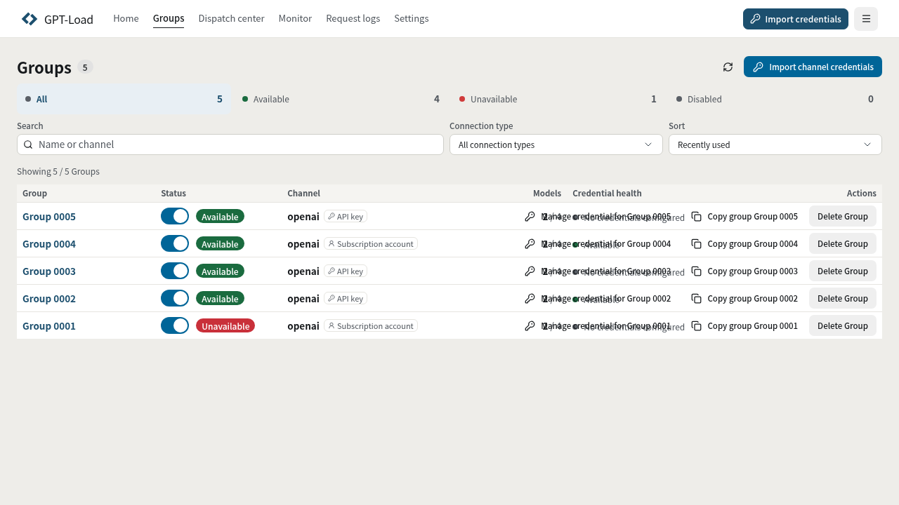

<div align="center">


# GPT-Load

**A self-hosted AI gateway for multi-channel, multi-credential setups**

API keys, traffic scheduling, failure handling, request logs, and usage accounting — behind a single entry point.

English · [中文](README_CN.md) | [Official Website](https://www.gpt-load.com)

> This checkout is the **[DabengBa/gpt-load](https://github.com/DabengBa/gpt-load)** repository. Any `tbphp/gpt-load` links retained below refer to upstream official release or container artifacts, not this repository.

[](https://github.com/tbphp/gpt-load/releases)
[](https://github.com/tbphp/gpt-load/pkgs/container/gpt-load)
[](LICENSE)

</div>

---

## Sponsors

<sub>[Become a sponsor](mailto:tangb7420@gmail.com)</sub>

<details open>
<summary>Sponsor details (collapsible)</summary>

<table>
<tbody>
<tr>
<td width="180"><a href="https://www.axisnow.io/zh"></a></td>
<td>Protect and accelerate websites and APIs, <strong>serving users in mainland China</strong> and around the world, and extend acceleration and security capabilities to native/mobile apps through a client SDK — <strong>self-built private-deployment CDN | subscription-based high-protection CDN | an independently controllable, flexibly composable CDN network.</strong></td>
</tr>
<tr>
<td width="180"><a href="https://go.apimart.ai/gh-gpt-load"></a></td>
<td>Thanks to APIMart for sponsoring this project! APIMart is a low-cost API platform for AI image &amp; video generation — GPT-Image-2 from $0.006/image, 160+ images per dollar. One async API covers both image and video: submit a task, get an ID, fetch results via polling or callback. Batch tens of thousands of images without timeouts, switch models without changing code. Pay-as-you-go with no monthly fee — <a href="https://go.apimart.ai/gh-gpt-load">sign up here</a> to get started.</td>
</tr>
</tbody>
</table>

</details>

## Why GPT-Load

Your application only needs one base URL and one AccessKey. Providers, accounts, credentials, models, and routing policy are all configured in the management UI.


- **One gateway, native protocols** — Manage official APIs, cloud platforms, model services, and compatible relays together while clients keep their OpenAI, Anthropic, or Gemini native interfaces.
- **API credential management** — Standard API and cloud credentials share scheduling, health handling, request logs and communication capture.
- **Scheduling and failure isolation built in** — Multi-credential scheduling, automatic weighting, retries, cooldown, blacklisting, and session affinity reduce the impact of overloaded or failing credentials.
- **Dedicated scheduling workspace** — Administrators can open `/schedule` to compare an external model's candidates across groups, batch-edit weights and priorities, inspect runtime state, recover cooled or blacklisted entries, and run single or batch probes.
- **Observable, self-hosted, and simple to deploy** — Inspect health, routes, logs with inline cache hit rates, usage, and cost estimates in an embedded UI backed by SQLite with local credential encryption.

## Quick start

> [!WARNING]
> If you are using 1.x, read [Moving from 1.x](#moving-from-1x) first. 2.0 cannot open, import, or migrate 1.x data in place.

> [!WARNING]
> **Breaking change: a database written by the previous release must be converted or replaced.** This build cannot open a legacy schema containing retired subscription structures in place; it refuses to start instead. Convert the stopped legacy database offline with `gpt-load convert-legacy-db --source <legacy.db> --target <new.db>` (keeps groups, API credentials, access keys and quota state, drops request logs and usage history), or start with a fresh database. There is no in-place migration, automatic deletion, or compatibility layer. Preserve the old deployment and backups. The full offline runbook lives in [`.agents/skills/gpt-load-operations/references/legacy-db-conversion.md`](.agents/skills/gpt-load-operations/references/legacy-db-conversion.md).

### 1. Start the service

Requires Docker and Docker Compose.

```bash
git clone --depth 1 https://github.com/DabengBa/gpt-load.git
cd gpt-load

cp .env.example .env
docker compose up -d
```

Confirm the service is up and read the generated management key:

```bash
curl --fail http://127.0.0.1:3001/health
docker compose exec gpt-load sh -c 'cat /app/data/auth.key'
```

Open <http://127.0.0.1:3001> and sign in to the console with that key. You can also set `AUTH_KEY` explicitly in `.env` before starting. By default the service listens on the loopback address only.

### 2. Initial configuration

1. **Add a channel** — Choose an upstream service and add one or more API keys.
2. **Create a group** — Pick a channel, then configure available models and runtime policy.
3. **Create an AccessKey** — Set the groups and client protocols it may use, then give the generated AccessKey to your application.

### Streaming responses

OpenAI Chat Completions, OpenAI Responses `create`, and Anthropic Messages SSE streams use buffered delivery: the upstream request stays streaming, but the gateway validates the complete event sequence and protocol terminal state before releasing the model payload once, in original order. Retries are allowed only before payload release and only for proven side-effect-free failures. Gemini and OpenAI Images keep live pass-through. Delivery thresholds, limits and error shapes are owned by the implementation and its tests.

## Screenshots

**Groups** — View channels, models, credential counts, and health in one place



**AccessKey read-only home** — Sign in with an AccessKey to view only its own groups, models, requests, usage, and cost allowance


**Usage and cost** — Review request trends, cache hit rate, token categories, and cost estimates


## Scope

Clients keep their native OpenAI, Anthropic, or Gemini interfaces. Each channel declares exactly which protocols and capabilities it can execute; GPT-Load converts between supported capabilities but is not a general-purpose translator. The current channel catalog is visible in the management UI and owned by the code. Product semantics live in [`.docs/db/`](.docs/README.md).

## Deployment and data

Docker Compose uses application-managed SQLite by default. Data lives in the `gpt-load-data` named volume and includes the database, `auth.key`, and `encryption.key`.

> [!IMPORTANT]
> `encryption.key` decrypts channel credentials. When backing up or migrating, the database and the key **must be kept together**. Once the key is lost or replaced, existing encrypted credentials cannot be recovered.

Common operations:

```bash
docker compose logs -f      # view logs
docker compose pull && docker compose up -d   # update to the latest 2.x image
docker compose stop         # stop the service
```

For request-log retention, SQLite status, offline maintenance, and recovery procedures, see [`.agents/skills/gpt-load-operations/references/sqlite-maintenance.md`](.agents/skills/gpt-load-operations/references/sqlite-maintenance.md).

<details>
<summary>Using a native binary</summary>

Download the build for your platform from the [upstream GitHub Releases](https://github.com/tbphp/gpt-load/releases) (upstream artifact), and verify it against the bundled `SHA256SUMS` first. Portable builds are provided for Linux amd64 and arm64.

</details>

### Environment configuration

At startup, the application reads `.env` in the current directory; existing process environment variables take precedence. See [`.env.example`](.env.example) for the configuration template; definitions and defaults are owned by the code and that template.

## Production considerations

- The service listens on `127.0.0.1` only by default. For remote access, expose it through a controlled network or a TLS reverse proxy, and configure ACLs and firewall rules.
- Manage `AUTH_KEY` and `ENCRYPTION_KEY` carefully. Never commit real keys to a repository, log, screenshot, or public issue.
- Debug communication capture is disabled by default and opt-in; captured plaintext may contain credentials and cookies. Operating constraints and the evidence boundary are owned by [`.agents/skills/gpt-load-operations/references/debug-capture.md`](.agents/skills/gpt-load-operations/references/debug-capture.md).
- 2.0 is designed for a **single application instance**. Instances do not share state, so horizontal scaling is not supported.
- Usage and cost are **estimates** derived from upstream responses. They support operational analysis and capacity planning, and do not equal a provider invoice or a financial reconciliation.

## Moving from 1.x

> [!WARNING]
> GPT-Load 2.0 is a complete rewrite. It **cannot** open, import, or migrate 1.x data in place.

Deploy 2.0 with its own database, `DATA_DIR`, port, and Docker volume. Cut traffic over only after verification, and keep the original 1.x deployment until the rollback window closes. Documentation for the 1.4.x maintenance line is at the [official docs](https://www.gpt-load.com/docs).

## Open-source dependencies

Some of GPT-Load's capabilities build on these projects, with thanks: [Bifrost Core](https://github.com/maximhq/bifrost) (Apache-2.0) for provider authentication, request/response conversion, streaming, and usage normalization; [Lobe Icons](https://github.com/lobehub/lobe-icons) (MIT) for channel brand icons. GPT-Load owns credential storage, account selection, scheduling, retry, health, affinity, logging, and usage policy.

Dependency versions are owned by [`go.mod`](go.mod) / [`go.sum`](go.sum) and [`web/pnpm-lock.yaml`](web/pnpm-lock.yaml); full license texts are in [`LICENSES/`](LICENSES/), and each release ships a CycloneDX SBOM covering the Go dependency graph.

Channel icons identify their respective upstream providers. All trademarks belong to their owners; this project is not affiliated with or endorsed by them.

## Project support

<table>
<tbody>
<tr>
<td align="center" width="33%">
<a href="https://openai.com/">
<picture>
<source media="(prefers-color-scheme: dark)" srcset="./screenshot/sponsor-openai-lockup-white.svg">
<source media="(prefers-color-scheme: light)" srcset="./screenshot/sponsor-openai-lockup-black.svg">

</picture>
</a>
<br><sub>Platform support</sub>
</td>
<td align="center" width="33%">
<a href="https://linux.do"></a>
<br><sub>Community support</sub>
</td>
<td align="center" width="33%">
<a href="https://www.digitalocean.com/?refcode=3d52cff21342&utm_campaign=Referral_Invite&utm_medium=Referral_Program&utm_source=badge"></a>
<br><sub>Infrastructure support</sub>
</td>
</tr>
</tbody>
</table>

---

[MIT License](LICENSE) · [Security policy](SECURITY.md) · [Contributing](CONTRIBUTING.md)
