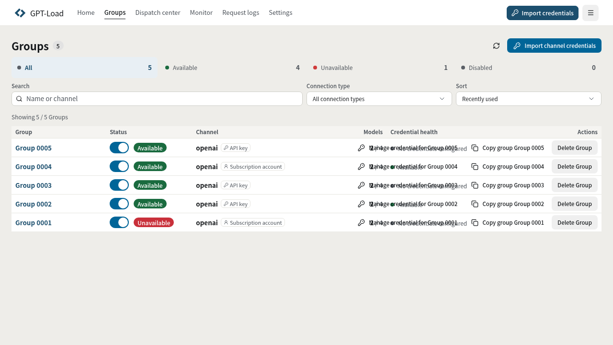

<div align="center">


# GPT-Load

**自托管 AI 网关，面向多渠道、多凭据场景**

API 密钥、流量调度、故障处理、请求日志与用量统计，全部收在单一入口之后。

[English](README.md) · 中文 | [官方网站](https://www.gpt-load.com)

> 本仓库是 **[DabengBa/gpt-load](https://github.com/DabengBa/gpt-load)**。下文保留的 `tbphp/gpt-load` 链接仅指上游官方发布物或容器产物，不是本仓库。

[](https://github.com/tbphp/gpt-load/releases)
[](https://github.com/tbphp/gpt-load/pkgs/container/gpt-load)
[](LICENSE)

</div>

---

## 赞助商

<sub>[成为赞助商](mailto:tangb7420@gmail.com)</sub>

<details open>
<summary>赞助商详情（可折叠）</summary>

<table>
<tbody>
<tr>
<td width="180"><a href="https://www.axisnow.io/zh"></a></td>
<td>保护并加速网站与 API，<strong>服务中国大陆及全球用户</strong>，并通过客户端 SDK 将加速与安全能力延伸到原生/移动应用——<strong>自建私有部署 CDN | 订阅制高防 CDN | 可自主掌控、灵活组合的 CDN 网络。</strong></td>
</tr>
<tr>
<td width="180"><a href="https://go.apimart.ai/gh-gpt-load"></a></td>
<td>感谢 APIMart 赞助本项目！APIMart 是面向 AI 图像与视频生成的低成本 API 平台——GPT-Image-2 每张 $0.006 起，1 美元可生成 160+ 张。一个异步 API 同时覆盖图像与视频：提交任务拿 ID，轮询或回调取结果。批量数万张图像不超时，换模型不改代码。按量付费无月费——<a href="https://go.apimart.ai/gh-gpt-load">点此注册</a>开始使用。</td>
</tr>
</tbody>
</table>

</details>

## 为什么选 GPT-Load

你的应用只需要一个 base URL 和一个 AccessKey。上游服务、账号、凭据、模型和路由策略全部在管理界面配置。


- **一个网关，原生协议** —— 把官方 API、云平台、模型服务与兼容中转统一管理，客户端继续使用 OpenAI、Anthropic 或 Gemini 原生接口。
- **API 凭据管理** —— 标准 API 凭据与云凭据共享调度、健康处理、请求日志与通信采集。
- **内置调度与故障隔离** —— 多凭据调度、自动加权、重试、冷却、拉黑与会话亲和，降低过载或故障凭据的影响。
- **专属调度工作台** —— 管理员可打开 `/schedule` 跨分组对比外部模型的候选上游、批量编辑权重与优先级、查看运行状态、恢复冷却/拉黑条目，并执行单个或批量测活。
- **可观测、自托管、部署简单** —— 在内嵌界面查看健康、路由、带内联缓存命中率的日志、用量与费用估算，后端为 SQLite 并本地加密凭据。

## 快速开始

> [!WARNING]
> 如果你在用 1.x，请先读[从 1.x 迁移](#从-1x-迁移)。2.0 无法原地打开、导入或迁移 1.x 数据。

> [!WARNING]
> **破坏性变更：上一版本写入的数据库必须转换或替换。** 本构建无法原地打开含退役订阅结构的旧 schema，会拒绝启动。请在停止后离线转换旧库：`gpt-load convert-legacy-db --source <legacy.db> --target <new.db>`（保留分组、API 凭据、访问密钥与配额状态，丢弃请求日志与用量历史），或使用全新数据库启动。没有原地迁移、自动删除或兼容层。保留旧部署与备份。完整离线流程见 [`.agents/skills/gpt-load-operations/references/legacy-db-conversion.md`](.agents/skills/gpt-load-operations/references/legacy-db-conversion.md)。

### 1. 启动服务

需要 Docker 与 Docker Compose。

```bash
git clone --depth 1 https://github.com/DabengBa/gpt-load.git
cd gpt-load

cp .env.example .env
docker compose up -d
```

确认服务已启动并读取生成的管理密钥：

```bash
curl --fail http://127.0.0.1:3001/health
docker compose exec gpt-load sh -c 'cat /app/data/auth.key'
```

打开 <http://127.0.0.1:3001> 用该密钥登录控制台。也可以在启动前于 `.env` 显式设置 `AUTH_KEY`。默认服务只监听回环地址。

### 2. 初始配置

1. **添加渠道** —— 选择一个上游服务并添加一个或多个 API 密钥。
2. **创建分组** —— 选定渠道，然后配置可用模型与运行策略。
3. **创建 AccessKey** —— 设置它可使用的分组与客户端协议，把生成的 AccessKey 交给你的应用。

### 流式响应

OpenAI Chat Completions、OpenAI Responses `create` 与 Anthropic Messages SSE 流采用缓冲交付：上游请求保持流式，但网关先校验完整事件序列与协议终态，再按原顺序一次性释放模型载荷。仅在载荷释放前且为已证实无副作用的失败时允许重试。Gemini 与 OpenAI Images 保持实时透传。交付阈值、限制与错误形状由实现及其测试拥有。

## 界面截图

**分组** —— 一处查看渠道、模型、凭据数量与健康状态



**AccessKey 只读主页** —— 用 AccessKey 登录后只看自己的分组、模型、请求、用量与费用额度


**用量与费用** —— 查看请求趋势、缓存命中率、token 分类与费用估算


## 适用范围

客户端保留 OpenAI、Anthropic 或 Gemini 原生接口。每个渠道只声明自己能执行的协议与能力；GPT-Load 在受支持的能力间转换，但不是通用翻译器。当前渠道目录在管理界面可见，由代码拥有。产品语义见 [`.docs/db/`](.docs/README.md)。

## 部署与数据

Docker Compose 默认使用应用自管理的 SQLite。数据存于 `gpt-load-data` 命名卷，包含数据库、`auth.key` 与 `encryption.key`。

> [!IMPORTANT]
> `encryption.key` 用于解密渠道凭据。备份或迁移时，数据库与密钥**必须一起保存**。密钥一旦丢失或替换，已加密凭据无法恢复。

常用操作：

```bash
docker compose logs -f      # 查看日志
docker compose pull && docker compose up -d   # 更新到最新 2.x 镜像
docker compose stop         # 停止服务
```

请求日志保留、SQLite 状态、离线维护与恢复流程见 [`.agents/skills/gpt-load-operations/references/sqlite-maintenance.md`](.agents/skills/gpt-load-operations/references/sqlite-maintenance.md)。

<details>
<summary>使用原生二进制</summary>

从 [upstream GitHub Releases](https://github.com/tbphp/gpt-load/releases)（上游产物）下载对应平台的构建，先对照随附的 `SHA256SUMS` 校验。提供 Linux amd64 与 arm64 的可移植构建。

</details>

### 环境配置

应用启动时读取当前目录的 `.env`；已有进程环境变量优先。配置模板见 [`.env.example`](.env.example)；定义与默认值由代码和该模板拥有。

## 生产注意事项

- 服务默认只监听 `127.0.0.1`。远程访问请通过受控网络或 TLS 反向代理暴露，并配置 ACL 与防火墙规则。
- 妥善管理 `AUTH_KEY` 与 `ENCRYPTION_KEY`。切勿把真实密钥提交到仓库、日志、截图或公开 issue。
- 调试通信采集默认关闭、按需开启；采集的明文可能包含凭据与 Cookie。运行约束与证据边界见 [`.agents/skills/gpt-load-operations/references/debug-capture.md`](.agents/skills/gpt-load-operations/references/debug-capture.md)。
- 2.0 面向**单应用实例**设计。实例间不共享状态，不支持水平扩展。
- 用量与费用是基于上游响应的**估算**。用于运维分析与容量规划，不等于供应商账单或财务对账。

## 从 1.x 迁移

> [!WARNING]
> GPT-Load 2.0 是完全重写。它**无法**原地打开、导入或迁移 1.x 数据。

请为 2.0 配备独立的数据库、`DATA_DIR`、端口与 Docker 卷。验证完成后再切流量，并保留原 1.x 部署直到回滚窗口结束。1.4.x 维护线的文档见[官方文档](https://www.gpt-load.com/docs)。

## 开源依赖

GPT-Load 的部分能力建立在这些项目之上，谨此致谢：[Bifrost Core](https://github.com/maximhq/bifrost)（Apache-2.0）提供上游认证、请求/响应转换、流式与用量归一化；[Lobe Icons](https://github.com/lobehub/lobe-icons)（MIT）提供渠道品牌图标。凭据存储、账号选择、调度、重试、健康、亲和、日志与用量策略由 GPT-Load 自有。

依赖版本由 [`go.mod`](go.mod) / [`go.sum`](go.sum) 与 [`web/pnpm-lock.yaml`](web/pnpm-lock.yaml) 拥有；完整许可文本在 [`LICENSES/`](LICENSES/)，每个发布附带覆盖 Go 依赖图的 CycloneDX SBOM。

渠道图标标识其对应上游供应商。所有商标归其所有者；本项目不隶属也不代表它们。

## 项目支持

<table>
<tbody>
<tr>
<td align="center" width="33%">
<a href="https://openai.com/">
<picture>
<source media="(prefers-color-scheme: dark)" srcset="./screenshot/sponsor-openai-lockup-white.svg">
<source media="(prefers-color-scheme: light)" srcset="./screenshot/sponsor-openai-lockup-black.svg">

</picture>
</a>
<br><sub>平台支持</sub>
</td>
<td align="center" width="33%">
<a href="https://linux.do"></a>
<br><sub>社区支持</sub>
</td>
<td align="center" width="33%">
<a href="https://www.digitalocean.com/?refcode=3d52cff21342&utm_campaign=Referral_Invite&utm_medium=Referral_Program&utm_source=badge"></a>
<br><sub>基础设施支持</sub>
</td>
</tr>
</tbody>
</table>

---

[MIT License](LICENSE) · [安全政策](SECURITY.md) · [参与贡献](CONTRIBUTING.md)
